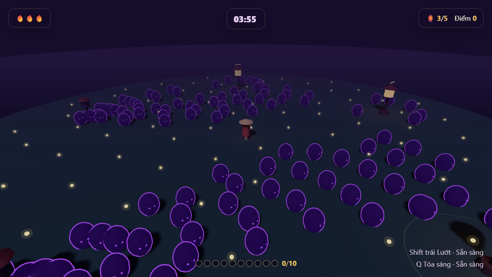

# Đảo Đèn Lồng v1.0.0

Game phiêu lưu 3D ba Đêm: giúp Mây thu thập đom đóm, giữ dầu cho các Đèn Lồng Lớn, chống Bóng Mực và duy trì ít nhất 60% ánh sáng tới bình minh.



## Yêu cầu hệ thống

- Windows 10/11, macOS hoặc Linux 64-bit.
- Node.js 24+ và npm 11+.
- Chrome, Edge hoặc trình duyệt WebGL2 hiện đại; GPU rời không bắt buộc để chơi.
- Benchmark tự động cần Chrome/Edge ở vị trí cài đặt chuẩn, hoặc biến môi trường `CHROME_PATH`.

## Cài đặt và chơi — tối đa 3 lệnh

```bash
git clone https://github.com/nguyencongquana2/K5-L3A-DAY12-NguyenCongQuan-2A202603675-AI-SDLC-Dao-Den-Long.git
cd K5-L3A-DAY12-NguyenCongQuan-2A202603675-AI-SDLC-Dao-Den-Long
npm --prefix game ci && node game/src/launcher/cli.js
```

Mở địa chỉ được in ra terminal, thường là `http://localhost:5173`. Bản web đóng gói trong GitHub Release chỉ cần giải nén và chạy `node serve.mjs`.

## Điều khiển

| Phím mặc định | Hành động |
|---|---|
| `W/A/S/D` | Di chuyển theo camera |
| Chuột | Xoay camera |
| `Space` | Nhảy |
| `Shift trái` | Lướt |
| `E` | Thắp, thắp lại hoặc châm dầu |
| `Q` | Tỏa sáng |
| `P` | Tạm dừng / tiếp tục |

Mọi phím gameplay đều đổi được và được lưu. Cài đặt còn có bảng màu dễ phân biệt, giảm chuyển động và chữ lớn ×1,25. HUD có chỉ báo hình ảnh cho Bóng Mực mới xuất hiện, gió, 10 giây cuối và đèn dưới 30 dầu.

## Luật và điểm

Mây có 3 Ngọn Lửa. Sức chứa bắt đầu ở 10, tăng 2 sau mỗi lần thắp thành công và tối đa 20. Đèn tiêu hao dầu và Bóng Mực có thể hút dầu của đèn yếu. Đêm chỉ kết thúc ở bình minh hoặc khi Mây hết Ngọn Lửa.

| Sự kiện | Điểm |
|---|---:|
| Mỗi đom đóm nạp vào đèn | 5 |
| Thắp lần đầu / thắp lại | 100 / 40 |
| Bóng Mực trúng Tỏa Sáng | 5; nếu đang hút dầu thì tổng 15 |
| Bình minh khi thắng | Mỗi đèn sáng: `50 + floor(dầu)`; mỗi Ngọn Lửa: 50 |

## Kiểm thử và headless

```bash
npm --prefix game run verify
npm --prefix game run build
node game/src/headless/cli.js --seed 1 --night 3 --ticks 18000 --out output.jsonl
```

Test Contract v1.3 vẫn chạy core cố định 60 tick/giây và không cần cửa sổ/GPU. `--night` nhận 1–3; scenario/input sai trả mã thoát 2.

## Benchmark

```bash
node game/src/bench/cli.js --seed 42 --duration 30 --out bench.json
```

Benchmark tạo viewport 1280×720, khởi động 3 giây rồi đo đúng thời lượng yêu cầu với 200 Bóng Mực và 100 đom đóm. Chrome được chạy bằng `--disable-frame-rate-limit` và `--disable-gpu-vsync`, vì vậy `vsync_off` được ghi `true`. Bản web không có API RSS tiến trình đáng tin cậy nên `peak_mem_mb` là `null`, đúng ngoại lệ của ticket. Số tự đo hiện tại nằm ở [`bench.json`](bench.json); máy chấm là kết quả quyết định.

## Soak test

```bash
node --expose-gc game/src/soak/cli.js --seed 7 --nights 10 --out soak.json
```

Mười Đêm chạy nối tiếp trong cùng tiến trình với input seeded đúng xác suất ticket. Kết quả tự đo nằm ở [`soak.json`](soak.json).

## Bảng xếp hạng

Điểm được lưu cục bộ sau khi thua hoặc thắng Đêm 3. Top 10 sắp theo điểm giảm dần và thời gian tăng dần. Khi chạy từ source, dữ liệu đồng bộ giữa `localStorage` và `game/.local/leaderboard.json`.

```bash
node game/src/launcher/cli.js --export-leaderboard out.json
```

## Tài liệu phát hành

- [Bằng chứng Phase 4](docs/proof/phase-4/README.md)
- [Ghi chú kỹ thuật Phase 4](docs/notes/phase-4.md)
- [Retro bốn phase](docs/retro/phase-4-retro.md)
- [Video demo MP4 15 giây](docs/demo/demo.mp4)
- [Changelog](CHANGELOG.md), [Credits](CREDITS.md), [MIT License](LICENSE)

Game dùng hình học thủ tục và WebAudio; không có model, texture, nhạc hoặc hiệu ứng âm thanh bên ngoài.
